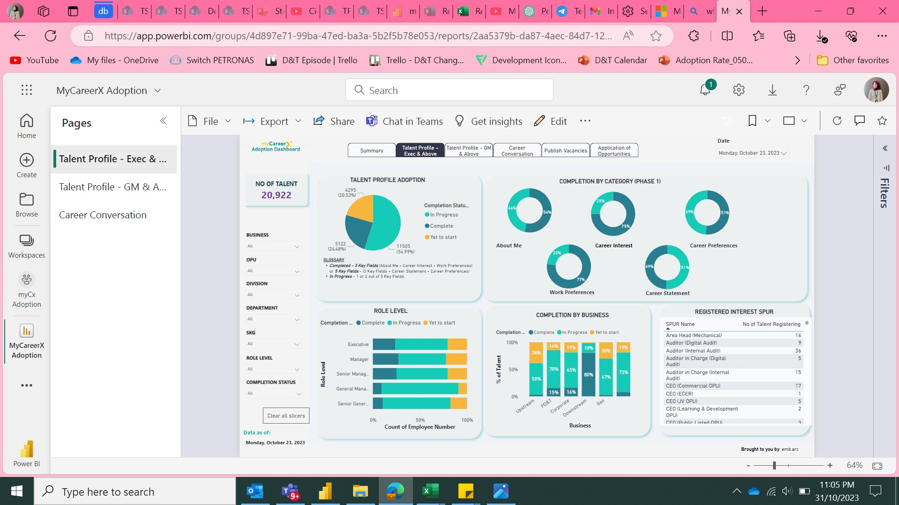
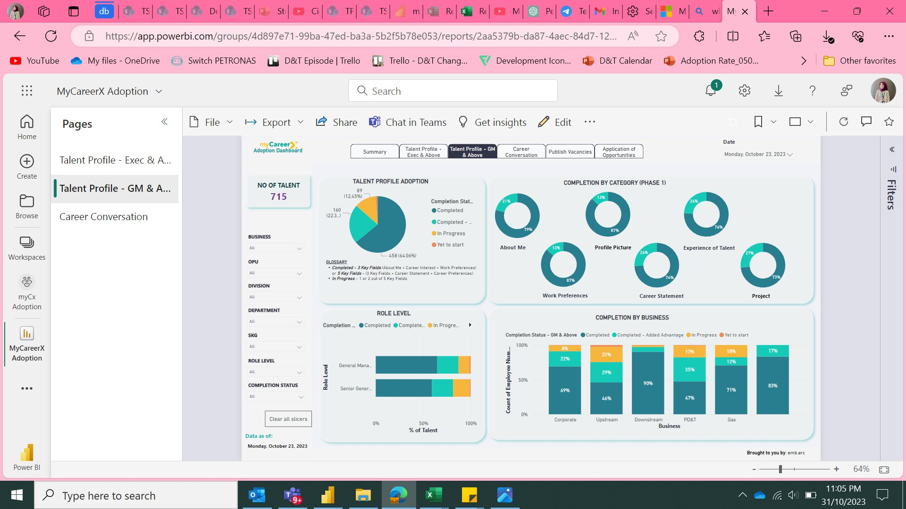
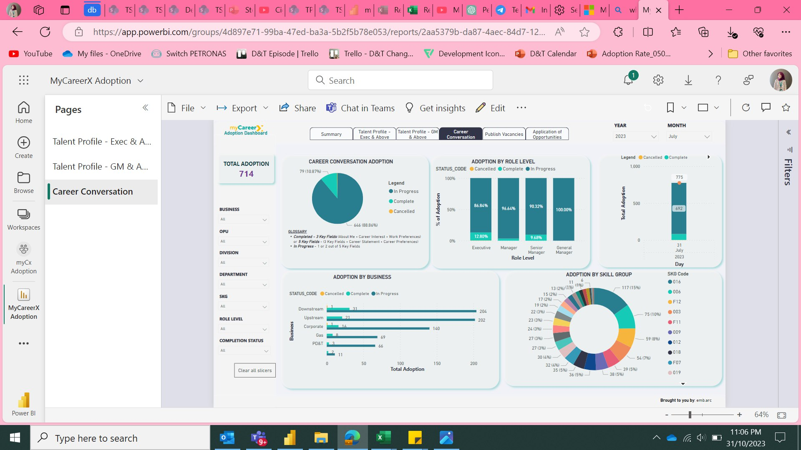
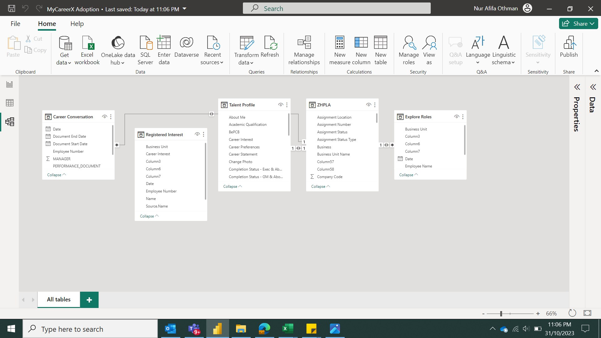

#Talent Profile Adoption Dashboard: Talent Profile & Career Conversation Analytics

> **Confidentiality note:** This project was built during my time at PETRONAS. All company data has been removed or replaced with anonymised sample data, and screenshots have been redacted. No real employee information, internal figures or system links are included in this repository.

## Project Overview

myCareerX is an internal career development platform where employees build a **Talent Profile** (career interests, preferences and statement) and record **Career Conversations** with their managers.

The business had a target of reaching **60% Talent Profile adoption**, but adoption was tracked manually and leadership had no single view of progress across the organisation. I designed and built this Power BI dashboard to give HR business partners and leadership a clear, up-to-date view of adoption, so they could spot lagging groups early and focus their engagement efforts.

## Business Questions

- What percentage of employees have completed, started or not yet started their Talent Profile?
- Which profile sections (e.g. About Me, Career Interest, Work Preferences) are employees most likely to skip?
- How does adoption differ by business, division, role level and skill group?
- How many Career Conversations have been completed, and where are they still in progress?
- Which roles are employees registering interest in?

## Dashboard Pages

| Page | What it shows |
|---|---|
| **Talent Profile – Executive & Above** | Overall adoption, completion by profile section, completion by role level and business, and registered interest by role |
| **Talent Profile – GM & Above** | The same view for senior leaders, including an extra "Completed – Added Advantage" status for optional fields |
| **Career Conversation** | Conversation status (complete, in progress, cancelled) by role level, business and skill group, plus a monthly trend |

All pages share slicers for **Business, OPU, Division, Department, Skill Group, Role Level and Completion Status**, so users can drill down to their own area.

### Completion Logic

- **Completed:** All 3 key fields (About Me, Career Interest, Work Preferences) or all 5 key fields filled in
- **In Progress:** 1 or 2 out of 5 key fields filled in
- **Yet to Start:** No key fields filled in

## Data Model

The model links five tables around a central employee master table:

- **Employee Master:** Employee details such as business, division, role level and assignment status
- **Talent Profile:** Profile section completion for each employee
- **Career Conversation:** Conversation records with start and end dates
- **Registered Interest:** Roles employees have registered interest in
- **Explore Roles:** Role browsing activity

Tables are joined on employee number, with one-to-one and one-to-many relationships.

## My Approach

1. **Requirements gathering:** Worked with product owners and HR business partners to define adoption KPIs, completion rules and the views each audience needed.
2. **Data preparation:** Extracted data with SQL, then cleaned and transformed it with Power Query (M), Python and R. This included handling missing values, standardising categories and flagging completion status.
3. **Data validation:** Ran quality checks to make sure counts and completion figures were accurate before release.
4. **Dashboard development:** Built the data model, DAX measures and report pages in Power BI, then refined the design based on stakeholder feedback.
5. **Testing and rollout:** Ran user acceptance testing from back end to front end, then published to the Power BI Service for leadership and HR teams.

## Impact

- Gave leadership a single, self-service view of adoption progress against the 60% target
- Helped HR teams identify which businesses, role levels and profile sections needed more engagement
- Replaced manual tracking with automated reporting, reducing reporting processing time by about 90%

## Tools

- **Power BI:** Data modelling, DAX, Power Query (M), Power BI Service
- **SQL:** Data extraction
- **Python and R:** Data cleaning and transformation

## Dashboard 





## Repository Contents

```
├── README.md
├── myCx_Adoption_Sample.pbix   # Dashboard with anonymised sample data
└── images/
    ├── talent_profile_exec.png
    ├── talent_profile_gm.png
    ├── career_conversation.png
    └── data_model.png
```

---

*Built by Nur Afifa Othman · [LinkedIn](https://www.linkedin.com/in/nurafifaothmn/)*
